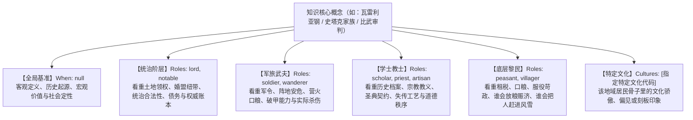
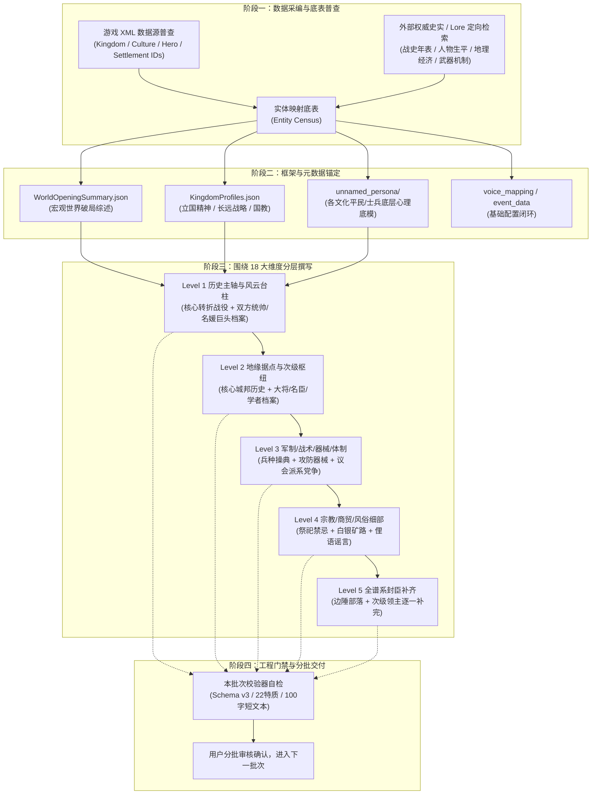
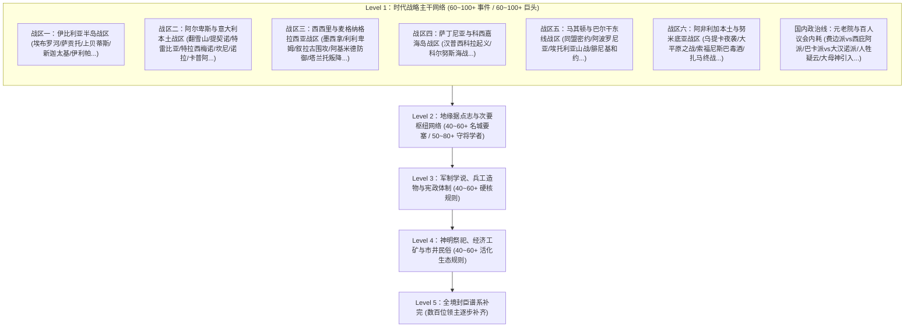

# AnimusForge 世界书制作与 AI 全自动生成全景指南

> **文档定位**：本指南是一份可以直接投喂给大语言模型（LLM）的**自包含型系统工程规范与创作 Prompt 指南**。任何接收本文件的 AI，均应依据本文档的规范、标准 Schema、18 大内容维度与多视角切片矩阵，自主搜索外部/原生背景资料（如中世纪历史、冰与火之歌、战锤、指环王、三国或自创 IP），直接生成符合 AnimusForge 模组规范的完整世界书数据包。

---

## 目录
1. [AI 创作者角色与任务定义](#1-ai-创作者角色与任务定义)
1.1 [世界观参数自适应初始矩阵（Worldview Parameter Matrix）](#11-世界观参数自适应初始矩阵worldview-parameter-matrix)
2. [世界书数据包顶层架构与文件契约](#2-世界书数据包顶层架构与文件契约)
3. [标准 JSON 数据结构与编写范例（全组件）](#3-标准-json-数据结构与编写范例全组件)
   - 3.1 宏观世界总纲：`WorldOpeningSummary.json`
   - 3.2 阵营开局综述：`KingdomOpeningSummaries.json`
   - 3.3 国家性格与战略：`KingdomProfiles.json`
   - 3.4 英雄与名人人设档案：`personality_background/*.json`
   - 3.5 动态知识切片规则：`knowledge/rules/*.json`（核心机制）
   - 3.6 语音与运行时配置：`VoiceMapping.json` / `EventRecords.json` / `UnnamedNpcProfiles.json`
4. [规则切片底层匹配评分算法（PickBestVariant）](#4-规则切片底层匹配评分算法pickbestvariant)
5. [18 大内容维度元素周期表（知识采集团队指南）](#5-18-大内容维度元素周期表知识采集团队指南)
6. [多阶层视角切片矩阵（6~8 视角流水线模板）](#6-多阶层视角切片矩阵68-视角流水线模板)
7. [动态占位符与高级状态机机制（TextMappings）](#7-动态占位符与高级状态机机制textmappings)
8. [标准代码白名单（技能与角色）](#8-标准代码白名单技能与角色)
9. [工业级渐进式写书 SOP（先查什么、先取什么、框架先行、分层撰写）](#9-工业级渐进式写书-sop先查什么先取什么框架先行分层撰写)
   - 9.1 [第一阶段：先调查什么？先获取什么？（双轨数据采编）](#91-第一阶段先调查什么先获取什么双轨数据采编)
   - 9.2 [第二阶段：先搭什么框架？（世界书地基与全局元数据锚定）](#92-第二阶段先搭什么框架世界书地基与全局元数据锚定)
   - 9.3 [第三阶段：围绕 18 大维度，先写什么？再写什么？（内容分层撰写优先级）](#93-第三阶段围绕-18-大维度先写什么再写什么内容分层撰写优先级)
   - 9.4 [第四阶段：分批推进与工程交付红线（AI 作业守则）](#94-第四阶段分批推进与工程交付红线ai-作业守则)
10. [质检红线与常见崩溃自查清单](#10-质检红线与常见崩溃自查清单)
11. [实战避坑血泪史与重大工程防错复盘（布匿战争战役总结）](#11-实战避坑血泪史与重大工程防错复盘布匿战争战役总结)
    - 11.1 [血泪教训一：人物文件名与 DisplayName 脱离 MOD 源码（“导入无效果”根因）](#111-血泪教训一人物文件名与-displayname-脱离-mod-源码导入无效果根因)
    - 11.2 [血泪教训二：国家档案只写头部大国，次级阵营大面积漏网](#112-血泪教训二国家档案只写头部大国次级阵营大面积漏网)
    - 11.3 [血泪教训三：知识规则关键词跨条目重复（触发 C# 导入硬性阻断）](#113-血泪教训三知识规则关键词跨条目重复触发-c-导入硬性阻断)
    - 11.4 [血泪教训四：英文文件名私自下划线化破坏严格匹配](#114-血泪教训四英文文件名私自下划线化破坏严格匹配)
    - 11.5 [交付前必须执行的四项“一票否决式”自动化验收脚本规范](#115-交付前必须执行的四项一票否决式自动化验收脚本规范)

---

## 1. AI 创作者角色与任务定义

当你接收到本指南并被指派为某一 IP（例如《冰与火之歌》、《战锤旧世界》、《魔戒》、《三国》、《水浒》或原创世界）制作世界书时，你的角色是 **AnimusForge 首席世界观架构师兼数据工程师**。

### 你的核心产出目标
构建一个存放于 `PlayerExports/<世界书名称>/` 路径下的完整数据文件夹，包含：
1. **宏观史诗综述**（全大陆与各政权开局局势分析）。
2. **国家战略与性格图谱**（各大势力的外交野心与地缘偏好）。
3. **风云人物档案库**（主要领主、军阀、重臣、传奇人物的深度人设）。
4. **动态多视角知识库**（涵盖政治、战争、神话、民俗、武器力学与阶级偏见的规则切片）。
5. **配套语音与环境基础配置**。

### 你的创作哲学
- **拒绝平铺直叙的维基百科**：现实世界充满欺瞒、偏见、阶级利益与神圣狂热。在 AnimusForge 中，同一件事在领主、老兵、修士与贫农嘴里应当是完全不同的面孔。
- **严守工程契约**：严格遵循双下划线命名法、字段长度上限、标点转义与属性白名单。

---

### 1.1 世界观参数自适应初始矩阵（Worldview Parameter Matrix）

AI 在正式动笔前，必须首先在内存中初始化以下 **4 大世界观元参数**。严禁用“欧洲中世纪封建思维”去套“东方三国演义”，或用“无魔冷兵器物理”去套“高魔奇幻”：

| 参数维度 | 考量核心 | 可选范式与典型世界观参考 | 强制指导规则 |
| :--- | :--- | :--- | :--- |
| **1. 题材范式**<br>`(Genre Archetype)` | 决定整个世界的底层物理、生存压力与技术/魔法天花板 | - **现实/拟真历史**（布匿战争、百年战争、十字军）<br>- **东方历史/演义传奇**（汉末三国、大唐安史、日本战国）<br>- **高魔/史诗奇幻**（战锤旧世界、魔戒、魔兽）<br>- **低魔/暗黑奇幻**（冰与火之歌、猎魔人）<br>- **科幻/废土末日**（辐射、赛博朋克） | 严禁跨题材混淆！如现实战史严禁出现魔法与神谕成真；东方演义必须强化名教气节与谶纬天命；高魔奇幻必须交代超自然力量的反噬代价。 |
| **2. 冲突拓扑**<br>`(Conflict Topology)` | 决定 Level 1 宏观主干网络的组织骨架 | - **地缘双雄决战型**（如罗马 vs 迦太基）<br>- **诸侯割据鼎足型**（如魏蜀吴三国、日本战国大名）<br>- **种族圣战天灾型**（如秩序阵营 vs 混沌天灾/异鬼）<br>- **帝国解体割据型**（如卡拉迪亚内战、西罗马衰亡） | 依据拓扑模型选择 Level 1 撰写范式：双雄选战区并进；诸侯选时代演进与政权主干；圣战选种族防线与裂隙；解体选派系理念争端。 |
| **3. 超自然与力学边界**<br>`(Metaphysics Boundary)` | 决定武器、神话与祭祀切片的真实性边界 | - **零魔硬物理**（冷兵器重心、盔甲破甲力学、粮道后勤）<br>- **低魔拟真**（极罕见超凡造物如瓦雷利亚钢、炼金野火）<br>- **高魔异界**（魔法八风、魔网反噬、神明降临、异兽冲阵） | 确定“神灵与魔法”是纯心理迷信慰藉，还是客观存在的高能物理干涉。高魔世界必须有严格施法门槛与代价体系。 |
| **4. 伦理与法理锚点**<br>`(Moral & Legal Anchor)` | 决定社会阶层的价值判断、忠诚逻辑与誓言约束 | - **西欧封建契约 / 教皇授勋神权**<br>- **东方家国宗法 / 名教礼义 / 禅让天命**<br>- **草原部族血誓 / 萨满神判 / 强者为王**<br>- **商业城邦公约 / 寡头元老法典 / 金融信用** | 角色行为必须受其文明伦理锚点约束。东方大将绝不会按封建采邑讲效忠，中世纪骑士绝不会为商业公约殉道。 |

---

## 2. 世界书数据包顶层架构与文件契约

每一个标准世界书包在磁盘上的物理结构必须严格保持如下 6 大子目录，不得增删顶层文件夹名：

```text
PlayerExports/<世界书名称>/
├── event_data/                      # [宏观叙事与历史记录]
│   ├── WorldOpeningSummary.json     # 全大陆开局宏观大局势深度综述（单对象）
│   ├── KingdomOpeningSummaries.json # 各大阵营开局独立地缘/政治/军事综述（KV字典）
│   └── EventRecords.json            # 历史事件记录容器（固定为初始空数组 []）
├── kingdom_profiles/                # [国家性格与长期战略]
│   └── KingdomProfiles.json         # 各大势力的性格偏好、扩张野心与运行参数
├── knowledge/                       # [核心动态知识库与多视角切片]
│   └── rules/                       # 存放成百上千条独立的规则切片 JSON
│       ├── rule_<前缀>__<第一关键词>.json
│       └── ...
├── personality_background/          # [具体英雄/NPC人设背景]
│   ├── <EntityId>__<DisplayName>.json
│   └── ...
├── unnamed_persona/                 # [无名NPC/路人身份扩展]
│   └── UnnamedNpcProfiles.json      # 路人/未命名NPC基础预设（标准包默认 Profiles 为 {}）
└── voice_mapping/                   # [TTS语音音色映射池]
    └── VoiceMapping.json            # 6大年龄段性别池 + fallback 音色配置
```

### 关键文件命名契约（双下划线法）
- **知识规则**：`rule_<Id>__<Keyword>.json`
  - 前半段为程序 ID（如 `rule_世界机制` 或 `rule_家族根基_史塔克`），后半段为该规则的第一关键词（如 `瓦雷利亚钢`），中间**必须使用双下划线 `__` 连接**！
- **人物档案**：`<EntityId>__<DisplayName>.json`
  - 前半段为游戏内的代码 StringId（如 `lord_1_1` 或 `CharacterObject_1795`），后半段为角色中文名（如 `卢孔`），中间**必须使用双下划线 `__` 连接**！
  - *严禁写成单下划线，否则游戏底层的实体反射解析器将无法提取 ID。*

---

## 3. 标准 JSON 数据结构与编写范例（全组件）

### 3.1 宏观世界总纲：`event_data/WorldOpeningSummary.json`
* **格式**：单个 JSON 对象，仅含一个 `"Summary"` 字符串。
* **字数与文风**：1500 ~ 2500 字，宏大庄重的史诗论调与宏观地缘政略剖析。
* **核心内容范式**：
  1. 当前时代断裂的根源（如铁王座继承危机、帝国三分内战、大分裂）。
  2. 大陆核心权力分布与各大强权的战略互搏。
  3. 决定战争走向的经济、商路、粮道与战略要冲。
  4. 边缘异族、跨海势力与远古超自然危机的苏醒。
  5. 局势脆弱性：明确说明未来任何一个领主的生死、一次围城都会引发何种连锁反应。

```json
{
  "Summary": "今之卡拉迪亚处在旧秩序解体与新秩序未定的阶段，整个大陆的权力分布已经脱离单一帝国中心，九个王国围绕各自的法统、利益、边境和统治结构进入长期竞争。最核心的断裂来自帝国三分...（展开详细的地缘与社会论述）...开局阶段的大陆特点可以概括为多国并立、中心失序、边境常战、节点争夺，未来任何一项重大事件都会沿着这些既有断裂扩散。"
}
```

---

### 3.2 阵营开局综述：`event_data/KingdomOpeningSummaries.json`
* **格式**：以势力代码 `kingdom_id` 为键的键值对集合。
* **写作模板（每个势力 1200 ~ 1800 字，严格遵循六段论）**：
  1. **地理风貌与核心城邦**：地势、骨架城镇、农业/矿产/林业资源、补给动脉。
  2. **统治法统与历史渊源**：君主名号、政权起源、臣民拥戴或服从的历史根基。
  3. **财政税源与经济模式**：农耕地产、商业关税、沙漠商道、战利品分赏或海盗劫掠。
  4. **军事学派与作战优势/短板**：标志性兵种编制、战术偏好（冲击/伏击/齐射/攻坚）、后勤依赖。
  5. **当期地缘交战危机**：正在与谁交战、边境争夺的焦点要塞与关口。
  6. **内政核心矛盾与未来动荡预测**：君臣博弈、地方豪强抗命、宗族世仇、继承人隐忧。

```json
{
  "vlandia": "瓦兰迪亚控制西海沿岸、丘陵平原和旧帝国西境的广大封地，是大陆上封建结构最成熟、骑士传统最完整的王国之一...（六段论详述）...",
  "battania": "巴旦尼亚占据西北群山、高地、森林和峡谷地带，是大陆上氏族传统最深、统一程度最低的王国之一...（六段论详述）..."
}
```

---

### 3.3 国家性格与战略：`kingdom_profiles/KingdomProfiles.json`
* **格式**：控制 AI 在外交系统、宣战与议和时的长期性格基准。

```json
{
  "Version": 1,
  "ExportedAtUtc": "2026-10-30T00:00:00.0000000Z",
  "Profiles": {
    "empire_north": {
      "KingdomId": "empire_north",
      "KingdomName": "北帝国",
      "CultureId": "empire",
      "RulerHeroId": "lord_1_1",
      "NationalPersonality": "以法统、元老院传统和严整秩序为最高准则；自认肩负保存旧制度责任，善用政治联盟，但不择手段排斥割据政权。",
      "LongTermStrategy": "以北方帝国的法统重新统一帝国：稳住核心行省，逐步削弱并吞并南方与西方割据势力，最终恢复单一中央政权。",
      "DefaultNationalPersonality": "以法统、元老院传统和严整秩序为最高准则...",
      "DefaultLongTermStrategy": "以北方帝国的法统重新统一帝国...",
      "DefaultSource": "authored_default",
      "HasPersonalityOverride": true,
      "HasStrategyOverride": true,
      "IsPlayerOverride": true,
      "RequiresFoundingGeneration": false,
      "GenerationState": "not_required",
      "GenerationAttemptCount": 0,
      "NextGenerationRetryDay": 0,
      "LastGenerationError": "",
      "CreatedDay": 1,
      "UpdatedDay": 1
    }
  }
}
```

---

### 3.4 英雄人设档案：`personality_background/<HeroId>__<Name>.json`（现行 Schema v3 标准）

> [!IMPORTANT]
> **底层代码演进注意（SchemaVersion 3）**：
> 早期模组版本（Schema v1/v2）仅包含宽泛的 `Personality` 与 `Background` 两个散文文本字段。在当前最新运行链路（见 `AF.Module.Persona/Generation/NpcPersonaTextRules.cs` 与 `NpcPersonaProfilePolicy.cs`）中，**人物档案已全面升级为 SchemaVersion 3 结构化心理学图谱**。
>
> 引擎在装载 Prompt 时，会通过 `BuildPersonaContext` 专门将 `Traits`、`Motivations`、`Values`、`Fears` 与 `SpeechStyle` 提取为结构化的独立系统指令行（如 `Core traits: ...`、`Current motivations: ...`），赋予大模型极其精准的心理锚点与演戏口吻，最后与全篇传略 `Description` 协同工作。

#### Schema v3 完整标准 JSON 结构
```json
{
  "HeroId": "lord_1_11",
  "HeroName": "史坦尼斯·拜拉席恩",
  "Description": "史坦尼斯·拜拉席恩是一个由矛盾铸成的男人。他的公正是一种近乎残酷的公正：他砍掉救命恩人戴佛斯的手指，因为走私就是犯罪；但他又册封其为骑士，因为有功必赏。他对原则的偏执最终逼迫他向红袍女的低语低头，用暗影巫术弑弟。五王之战爆发后，他自视铁王座唯一正统继承人，在黑水河烈焰覆灭后仍率部北上长城，誓要夺回信念中的王位。",
  "Traits": [
    {
      "Id": "dutiful",
      "Strength": 3
    },
    {
      "Id": "calculating",
      "Strength": 2
    },
    {
      "Id": "vengeful",
      "Strength": 2
    },
    {
      "Id": "reserved",
      "Strength": 2
    }
  ],
  "Motivations": [
    "以劳勃唯一合法继承人的身份夺回铁王座",
    "向封锁风息堡与背弃誓言的南方贵族讨还血债",
    "在绝境长城击退塞外野人并证明自己是拯救王国者"
  ],
  "Values": [
    "法律与责任高于个人感情与血缘纽带",
    "有功必赏，有罪必罚，两者不可互相抵消",
    "国王有义务保卫王国，哪怕臣民并不爱戴他"
  ],
  "Fears": [
    "铁王座落入乱伦私生子与僭主之手",
    "自己坚守的绝对正义被证明毫无意义且无人追随"
  ],
  "SpeechStyle": "语调冷峻生硬，习惯用短促有力的军令口吻，极少修饰言辞，常伴随咬牙声，从不说谄媚或客套的废话",
  "SchemaVersion": 3,
  "VoiceId": ""
}
```

#### 核心字段规范与限制
1. **`Description`（综合生平与性格传略）**：
   - 现行主字段。要求将人物的性格底色、关键人生战役、内心矛盾与当前处境熔炼为一篇 **300 ~ 600 字的高质量散文**。
   - *向下兼容机制*：如果读取到旧版文件，底层 `NpcPersonaProfilePolicy.ResolveDescription` 会自动将旧的 `Personality` 与 `Background` 拼接进 `Description`，但新制作的世界书必须直接生成 `Description`。
2. **`Traits`（核心特质列表，数组）**：
   - 包含 `{ "Id": "...", "Strength": 1~3 }` 对象。
   - `Id` **必须严格从 22 个官方白名单中选取**（见第 8.3 节），不可自造。
   - `Strength` 为强度数值（1 = 轻微表现，2 = 显著特质，3 = 支配级主导特征），通常配置 2 ~ 5 个核心特质。
3. **`Motivations`（当前驱动目标，字符串数组）**：
   - 记录该人物当前最迫切的欲望与行动目标。
   - **数量限制**：最多 **3 条**；每条字符上限 **180 字符**。
4. **`Values`（价值观与行为底线，字符串数组）**：
   - 记录该人物行事的道德戒律与不可妥协的底线。
   - **数量限制**：最多 **3 条**；每条字符上限 **180 字符**。
5. **`Fears`（弱点与内心恐惧，字符串数组）**：
   - 记录该人物最害怕发生的灾难或精神创伤点。
   - **数量限制**：最多 **2 条**；每条字符上限 **180 字符**。
6. **`SpeechStyle`（对话语调与言语习惯，字符串）**：
   - 描述该人物在自然语言交流中的语速、口癖、用词习惯与情绪外在特征。
   - **字符上限**：**240 字符**。
7. **`SchemaVersion`**：
   - 固定填整数 `3`。
8. **`VoiceId`**：
   - 专属 TTS 发音人 ID，若无专属音色直接留空字符串 `""`（游戏会自动按 VoiceMapping 分配）。

---

### 3.5 动态知识切片规则：`knowledge/rules/rule_<Id>__<Keyword>.json`

知识规则是世界书最具技术含量的核心。一条合格的规则包含关键词触发器、向量检索短语、多视角变体阵列与动态替换参数。

```json
{
  "Id": "rule_世界机制__瓦雷利亚钢",
  "Keywords": [
    "瓦雷利亚钢",
    "族剑",
    "魔法钢",
    "重铸"
  ],
  "RagShortTexts": [
    "瓦雷利亚钢：轻韧锋利、带水波纹的失传钢材，多为古老家族珍藏，能伤害异鬼却无法量产。"
  ],
  "SemanticPrototypes": [],
  "Variants": [
    {
      "Priority": 0,
      "When": null,
      "Content": "瓦雷利亚钢比普通钢更轻、更坚韧，也能保持惊人的锋利，剑身常带烟色或水波般纹路。自由堡垒覆灭后锻造秘密失传，少数顶尖工匠仍能重铸旧钢，却无法凭寻常矿料制造新剑。它是古老家族身份与继承权的证明，其稀少数量决定了它永远不是普及军队的答案。"
    },
    {
      "Priority": 0,
      "When": {
        "HeroIds": null,
        "Cultures": null,
        "KingdomIds": null,
        "SettlementIds": null,
        "Roles": [ "lord", "notable" ],
        "IdentityIds": null,
        "IsFemale": null,
        "IsClanLeader": null,
        "SkillMin": null
      },
      "Content": "贵族看瓦雷利亚钢，常先看剑名与传承。失去族剑会被视作家门残缺，得到别家旧剑也可能带来荣耀之外的质疑与仇怨。"
    },
    {
      "Priority": 0,
      "When": {
        "HeroIds": null,
        "Cultures": null,
        "KingdomIds": null,
        "SettlementIds": null,
        "Roles": [ "soldier", "wanderer" ],
        "IdentityIds": null,
        "IsFemale": null,
        "IsClanLeader": null,
        "SkillMin": null
      },
      "Content": "战士敬畏它的平衡与锋利，普通铁匠连给它打磨的资格都没有。但说实话，在烂泥地和箭雨里，再好的神剑也救不了一个被长矛扎穿肚子的蠢货。"
    },
    {
      "Priority": 0,
      "When": {
        "HeroIds": null,
        "Cultures": null,
        "KingdomIds": null,
        "SettlementIds": null,
        "Roles": [ "peasant", "villager" ],
        "IdentityIds": null,
        "IsFemale": null,
        "IsClanLeader": null,
        "SkillMin": null
      },
      "Content": "一把剑换一座城堡？那些老爷们脑子坏了。俺们只知道，拿瓦雷利亚钢切菜也不会让黑面包变软，老爷们拔剑的时候，倒霉的准是俺们的麦田。"
    }
  ],
  "TextMappings": []
}
```

---

### 3.6 语音与运行时配置

#### `voice_mapping/VoiceMapping.json`
用于为各性别、年龄段分配 TTS 语音发音人。必须包含以下 6 个数组及合法的 `fallback`：
```json
{
  "male_young": [ "zh_male_M100_conversation_wvae_bigtts" ],
  "male_middle": [ "zh_male_baqiqingshu_mars_bigtts", "ICL_zh_male_lengjunshangsi_tob" ],
  "male_old": [ "zh_male_qingcang_mars_bigtts" ],
  "female_young": [ "zh_female_shuangkuaisisi_moon_bigtts" ],
  "female_middle": [ "ICL_zh_female_linjuayi_tob", "zh_female_wenrouxiaoya_moon_bigtts" ],
  "female_old": [ "ICL_zh_female_heainainai_tob" ],
  "fallback": "zh_male_baqiqingshu_mars_bigtts"
}
```

#### `event_data/EventRecords.json`
* 固定初始化为一个空的 JSON 数组：`[]`。用于游戏在运行过程中动态写入历史战事和重大事件记录。

#### `unnamed_persona/UnnamedNpcProfiles.json`
* 固定初始化为默认结构：
```json
{
  "Version": 1,
  "Profiles": {}
}
```

---

## 4. 规则切片底层匹配评分算法（PickBestVariant）

AI 编写规则变体时，必须理解 AnimusForge 底层的 **变体择优挑选算法**（源码见 `KnowledgeLibraryBehavior.cs`）：

```text
得分 (Score) 计算规则：
  - When 为 null（通用兜底）：Score = 0 分
  - 每一个匹配当前 NPC 的非空条件字段，Score 累加 1 分：
    + HeroIds 匹配：+1 分
    + Cultures 匹配：+1 分
    + KingdomIds 匹配：+1 分
    + SettlementIds 匹配：+1 分
    + Roles 或 IdentityIds 匹配：+1 分
    + IsFemale 判定吻合：+1 分
    + IsClanLeader 判定吻合：+1 分
    + SkillMin 技能门槛全部达标：+1 分

判定胜出者：
  1. 取所有变体中 Score 最高的那一个！
  2. 若有多项变体 Score 平分，取 SkillMin 技能阈值数值总和更高者。
```

> [!IMPORTANT]
> **AI 创作原则**：
> - **必定包含一个 `When: null` 的通用变体**（0分兜底），确保任何路人触发关键词时都有话可说。
> - **条件越严密，分值越高**：如【北境文化 + 领主角色】（2分）会自动覆盖纯【北境文化】（1分）变体；【指定特定英雄 ID】（1~2分）能够保证核心名人的定制台词绝对优先登场。

---

## 5. 18 大内容维度元素周期表（知识采集团队指南）

当 AI 面对一个全新的世界观时，严禁漫无目的地抓取资料。AI 必须逐一对照以下 **18 大内容维度元素周期表** 进行检索与规则建立：

| 层次划分 | 维度序号与名称 | 检索关键词与核心内容覆盖指引 |
| :--- | :--- | :--- |
| **宏观秩序** | **1. 地缘格局与列国通论** | 大陆板块、各大主权势力（王国/城邦/游牧）、建国起源、法统主张、战略缓冲带。 |
| | **2. 政治体制与王冠秩序** | 中央权力架构（元老院/御前会议/苏丹庭）、王权边界、大议会继承判例、摄政权、守护者职能。 |
| | **3. 历史因果连锁编年** | 严格按时间因果排布的重大事件链（起因 $\to$ 激化 $\to$ 决战 $\to$ 反弹 $\to$ 停战）。 |
| | **4. 国际条约与法理降表** | 历史停战条约的详细条款：领土分割线、赔款数额、驻军限制、非军事区、遗留争议。 |
| **力量冲突** | **5. 军事编制与战术力学** | 武器物理力学（重心/破甲/形变）、典型阵型克制、三线轮替、攻城机械力学、战利品分配。 |
| | **6. 名门望族与血脉宿怨** | 贵族家系图谱、封地发家史、家徽与格言、世仇宗族血债、政治联姻网络。 |
| | **7. 核心风云人物传略** | 君王、元帅、教皇、名将的性格暗面、行事准则、道德挣扎与第一人称自白。 |
| | **8. 刑罚体系与司法阶级** | 法律在贵族与平民间的双重标准、比武审判、放逐流放制度、客宴权利（神圣庇护戒律）。 |
| **奇幻生态** | **9. 超自然法则与魔法代价** | 宇宙底层能量流动、魔法施放禁忌、肉体异变、灵魂反噬代价、传说圣物与炼金术。 |
| | **10. 非人种族心智与生态** | 彻底脱离人类思维的种族特质：异质生理周期、种族狂热机制、永恒仇恨执念。 |
| | **11. 多神信仰、神权与异端** | 各教派神学戒律、宗教圣典、教团武装、绝罚权、殉道圣迹、异端审判与活人祭祀。 |
| | **12. 战略水文与地理档案** | 核心山脉隘口、大河渡口、沼泽堤道、洋流风向、暗礁海峡与咽喉城堡。 |
| **社会生计** | **13. 主权债务、金融与铸币** | 国库财政危机、军费发放模式、国际高利贷银行制约、贵金属矿脉、劣币驱逐良币。 |
| | **14. 跨洋大宗贸易与商路** | 跨区域大宗商品流转（粮/盐/马/木材/布匹/奴隶）、关税垄断、商队与海运航道。 |
| | **15. 微观生存史：饮食与医药** | 底层口粮配给、冬储生存计算、饥荒救济、传统草药与毒药、截肢烧灼、瘟疫封城。 |
| | **16. 婚丧礼法、民俗与私生** | 各文化婚礼与海葬仪式、私生子命名地域规则与社会歧视、座次尊卑礼节、集市行会。 |
| | **17. 知识垄断与信息信使网** | 学者学术殿堂（学城/大学）、渡鸦/快马驿传体系、知识封锁与历史窜改。 |
| | **18. 灰色地下社会与黑市江湖** | 城市跳蚤窝、妓院情报中枢、黑市走私网络、盗匪行规行话、流浪歌手政治讽喻诗。 |

---

## 6. 多阶层视角切片矩阵（6~8 视角流水线模板）

为保证写出来的世界书极度真实，AI 在编写核心概念规则时，应套用如下 **标准阶级切片矩阵**（权游与战锤实战模板）：



### 视角生成示例对照表（以“客宴权利 / 面包与盐”为例）
1. **全局（When: null）**：“受远古诸神见证的古老神圣契约，客人吃下主人的食盐与面包后，双方在留宿期间严禁相互伤害，违者被视为人神共诛。”
2. **领主视角（Roles: lord）**：“这是乱世中维持封建谈判的底线。连客宴权利都敢践踏的领主，将永远失去政治信誉，其名声会被全大陆诸侯共同唾弃。”
3. **士兵视角（Roles: soldier）**：“在敌人的厅堂里，只有看见面包和盐端上来，老子才敢解下佩剑。破坏规矩的人，最好在睡梦里把脖子硬起来。”
4. **底层百姓（Roles: peasant）**：“老爷们在大厅里发誓，俺们不懂。俺们只知道，哪怕是逃荒的乞丐敲门，分他一口盐水，旧神也会保佑家里的炉火不灭。”

---

## 7. 动态占位符与高级状态机机制（TextMappings）

为避免世界书在游戏运行数十年后出现“原国王已死但文本还在歌颂他”的硬编码穿帮，AI 应熟练运用动态替换机制。

### 7.1 名字与实体替换
在 `Content` 中书写大写英文字母（如 `A`、`B`），并在 `TextMappings` 数组中声明对应提取规则：
```json
"TextMappings": [
  {
    "SourceText": "A",
    "Kind": "kingdom_leader_name",
    "TargetId": "empire_west"
  },
  {
    "SourceText": "B",
    "Kind": "settlement_owner_leader_name",
    "TargetId": "town_EW6"
  }
]
```

### 7.2 状态判定与文本分支（Status Mapping）
当需要根据实体当前的死活、受困、交战状态输出不同台词时使用：
- **`Kind` 格式**：`status|<对象来源>|<状态代码>`
  - 英雄状态：`status|hero|is_alive`、`status|hero|is_prisoner`、`status|hero|is_ruler`
  - 王国状态：`status|kingdom|is_at_war`、`status|kingdom|is_eliminated`
  - 定居点状态：`status|settlement|is_under_siege`
- **控制字段**：
  - `TrueText`：为真时替换为的文本（如：“尚在人世”）。
  - `FalseText`：为假时替换为的文本（如：“早已阵亡”）。
  - `EmptyValueText`：无效时的兜底文本。

### 7.3 内置自动动态目标宏（Auto Target IDs）
无需硬编码具体 ID，可在 `TargetId` 中直接填入以下宏：
- `__current_npc__`：当前正在对话的 NPC。
- `__player__`：玩家。
- `__bound_kingdom__`：本条知识绑定的王国。
- `__bound_settlement__`：本条知识绑定的定居点。
- `__bound_hero__`：本条知识绑定的英雄。

---

## 8. 标准代码白名单（技能与角色）

AI 在编写 `When` 条件时，**严禁自行捏造英文单词**，必须严格使用以下游戏引擎底层识别的代码：

### 8.1 官方标准身份角色（Roles 白名单）
- `lord`：封建领主、贵族、族长、廷臣。
- `notable`：城镇要人、巨商大贾、黑帮头目、工匠行会长。
- `wanderer`：流浪者、同伴、酒馆雇佣武士。
- `soldier`：正规军卫兵、士卒。
- `villager`：乡村农民、佃户。
- `townsfolk`：城镇市民、小手工业者。
- `commoner`：通用底层路人。

### 8.2 官方标准技能代码（SkillMin 白名单）
*大小写不敏感，但建议按标准大小写书写：*
- **战斗战技**：`OneHanded`（单手）、`TwoHanded`（双手）、`Polearm`（长杆）、`Bow`（弓箭）、`Crossbow`（弩弓）、`Throwing`（投掷）、`Riding`（骑术）、`Athletics`（跑动）、`Crafting`（锻造）
- **统御谋略**：`Tactics`（战术）、`Scouting`（侦察）、`Roguery`（流氓习气）、`Leadership`（统御）
- **民事治理**：`Charm`（魅力）、`Trade`（交易）、`Steward`（管理）、`Medicine`（医术）、`Engineering`（工程）

### 8.3 官方标准性格特质代码（Traits 白名单与强度）
*底层由 `AF.Module.Persona/Generation/NpcPersonaTextRules.cs` 严格白名单校验，`Strength` 取值必须在 `1` 到 `3` 之间（1 = 轻度，2 = 显著，3 = 支配主导）：*
- **进取与勇气**：`bold`（果敢勇猛）、`cautious`（谨慎戒备）、`ambitious`（野心勃勃）、`curious`（好奇探究）
- **道德与正义**：`honorable`（重荣誉恪守誓言）、`merciful`（仁慈宽厚）、`ruthless`（冷酷残忍）、`dutiful`（恪尽职守）
- **权谋与理性**：`pragmatic`（务实实用）、`calculating`（精于算计城府深）、`opportunistic`（见风使舵投机）、`suspicious`（多疑猜忌）
- **脾性与社交**：`patient`（沉着隐忍）、`impulsive`（急躁冲动）、`loyal`（忠心耿耿）、`vengeful`（睚眦必报记仇）、`proud`（孤傲自尊）
- **处事与日常**：`generous`（慷慨仗义）、`frugal`（节俭吝啬）、`sociable`（热情善交际）、`reserved`（孤僻克制内敛）、`disciplined`（严于律己纪律严明）

---

## 9. 工业级渐进式写书 SOP（先查什么、先取什么、框架先行、分层撰写）

> [!CAUTION] 核心工程铁律：严禁单轮敷衍与脚本批量刷水数据
> 一套成熟的 AnimusForge 工业级世界书通常包含数十万字的高密度历史考据、上百条多视角规则与数十位深度领主档案。**没有任何 AI 能够在单轮对话中直接写出全量高质量世界书**！
> 试图在单轮中“一口气写完所有内容”必然导致两种致命变形：
> 1. **断头式偷工减料**：仅写 10 余条简略骨架，便宣称“全景已完成”；
> 2. **敷衍式脚本拼凑 / 复制粘贴**：用粗糙脚本从旧数据包或通用模板中批量洗稿刷数据，产生大量脱离史实的模板化垃圾。
> 
> **正确的执行原则是：先调研对齐，再搭建骨架；围绕 18 大维度分层推进；每一轮只攻坚 1~2 个层级，步步验收，渐进成书。**



---

### 9.1 第一阶段：先调查什么？先获取什么？（双轨数据采编）

在落笔写任何一条具体规则或人物之前，AI 必须严格执行“游戏底层代码”与“外部权威史料”的双轨调查：

#### 轨一：游戏底层实体代码普查（Game Entity Census）
严禁凭空脑补任何英文 ID！必须首先从目标模组的 `ModuleData/` 或工程源码中读取提取真实代码：
1. **阵营代码 (`KingdomIds`)**：
   - 查阅 `spkingdoms.xml`，提取真实的 `id`（如 `empire_s` 代表罗马共和国、`aserai` 代表迦太基、`empire` 代表马其顿等），明确统治者 (`owner`) 与附属关系。
2. **文化代码 (`Cultures`)**：
   - 查阅 `spcultures.xml`，提取标准文化 ID（如 `empire`、`aserai`、`numidian`、`greek`、`battania`、`vlandia`、`sturgia` 等）。
3. **关键人物代码 (`HeroIds`)**：
   - 查阅 `lords.xml`、`heroes.xml`、`spnpccharacters.xml`，提取风云人物的真实代码（如 `lord_3_1` 为汉尼拔、`lord_1_27_2` 为大西庇阿、`er_lord_massyli_1` 为马西尼萨等）。
4. **地理据点代码 (`SettlementIds`)**：
   - 查阅 `settlements.xml`，提取全图重要城市、要塞的真实 ID（如 `town_V6` 为罗马、`town_wre_carthagonova` 为新迦太基等）。
5. **官方文本映射**：
   - 查阅语言包（如 `Languages/CNs/`），确保人物中文译名、城邦名与游戏内完全一致。

#### 轨二：外部权威史实 / 背景 Lore 检索（Deep Lore Retrieval）
针对模组时代（如第二次布匿战争、三国鼎立、劳勃叛乱、十字军东征等），使用网络搜索或权威史料库，定向检索以下核心素材：
- **历史大事年表**：从导火索事件到终战和约的每一场关键转折战役（时间、地点、双方统帅、兵力悬殊、战术胜因、伤亡后果）。
- **历史人物生平与深层心理**：核心人物的家庭背景、早年誓言、重大挫折、性格阴暗面、政治盟友与宿敌、临战经典名言。
- **军事机制与冷门细节**：特殊武器的形制与力学原理（如破甲标枪弯折机制、内弯刀劈刺威力、战象惊象号角战术、起重飞爪杠杆力学）。
- **地缘经济与宗教风俗**：矿山产地、粮食航运、主神祭祀、特殊禁忌（如人牲、神谕所、血誓、待客之礼）。

---

### 9.2 第二阶段：先搭什么框架？（世界书地基与全局元数据锚定）

在获得实体索引与史料库后，必须**首先建立全包的基础骨架容器**，锁死全局世界观与心理基调：

1. **`event_data/WorldOpeningSummary.json`（全局历史开局综述）**：
   - 约 1500~2000 字，描摹开局关键历史破局点的宏观态势、深层地缘矛盾与山雨欲来的史诗感。
2. **`event_data/KingdomOpeningSummaries.json`（各阵营开局综述）**：
   - 为地图上各大主要参战阵营分别撰写开局综述，明确其内部分裂、外敌威胁与开局战略目标。
3. **`kingdom_profiles/KingdomProfiles.json`（国家性格与长远战略）**：
   - 定义各大阵营的立国精神（NationalPersonality）、长远战略（LongTermStrategy）与国教信仰（Religion）。这是后续所有变体判定和角色立场的情感锚点。
4. **`unnamed_persona/`（各种族/文化底层路人心理底模）**：
   - 覆盖所有主要文化的平民/士兵心理底模（如罗马公民步兵、迦太基商贾佣兵、努米底亚骑手、希腊哲人技师等），奠定各文化的底层社会面貌。
5. **基础配置闭环**：
   - `voice_mapping/VoiceMapping.json`（配置各年龄段音色与合法 fallback）与 `event_data/EventRecords.json`（置为初始空数组 `[]`）。

---

### 9.3 第三阶段：围绕 18 大维度，先写什么？再写什么？（内容分层撰写优先级）

> [!IMPORTANT] 认知纠偏：拒绝“高考试卷式抽样”，拥抱“全景多战区网状展开”
> 很多 AI 在撰写 Level 1 核心内容时，往往陷入“抽样思维”——仅仅挑选三五个耳熟能详的大决战（如只挑坎尼、扎马）和几个大统帅（如只挑汉尼拔、西庇阿），草草写上十几条就宣称“核心已写完”。**这是绝对错误的残废架构**！
> 真实的历史战争或史诗奇幻（如第二次布匿战争、三国争霸、劳勃叛乱、五王之战）绝非单线发展的流水账，而是由**多战区、多战线、多家族在十数年间交织形成的庞大战争网络**。
> **Level 1 的“核心”，指的是“战略主轴骨干”，绝不等于“数量缩水”！**
> 仅 Level 1 这一层级，就应当包含 **60 ~ 100+ 条多战区核心战役与历史事件规则**，以及 **60 ~ 100+ 位核心主政将领与阵营巨头档案**！



---

#### 🏛️ Level 1：第一梯队——时代核心矛盾演进网络与主权骨干群像（60 ~ 100+ 事件 / 60 ~ 100+ 人物）
> **目标**：以最高密度的背景史料，网状铺开整个时代的全部核心战略转折点与主导各方的决策巨头，奠定不可动摇的世界观主干。

AI 在构建 Level 1 主干时，必须根据第 1.1 节确定的【冲突拓扑】模型，选择对应的**网络化铺开范式**（拒绝单线流水账与偷懒抽样）：

##### 🌐 Level 1 四大典型题材拓扑范式：
- **范式 A：地缘多战区双雄决战型（如布匿战争、十字军东征、百年战争）**：
  * 按 5~8 个独立展开又彼此联动的大战区（Theaters of War）分批推进。
- **范式 B：诸侯割据与鼎立演进型（如汉末三国演义、日本战国时代、罗马三头内战）**：
  * 按 4~6 个时代演进断代（如群雄逐鹿 $\to$ 官渡争霸 $\to$ 赤壁鼎立 $\to$ 夷陵与六出祁山）+ 3~4 个主权阵营（曹魏、蜀汉、东吴、汉室遗臣）骨干群像推进。
- **范式 C：种族圣战与灭世天灾型（如战锤全战混沌入侵、魔戒中土圣战、冰与火之歌长夜）**：
  * 按文明同盟主防线（帝国-矮人-高精）vs 毁灭天灾裂隙（混沌-绿皮-死灵）的攻防主轴推进。
- **范式 D：帝国解体与边疆内附型（如原版卡拉迪亚内战、西罗马覆灭与日耳曼南迁）**：
  * 围绕核心创伤决战（如佩德拉克战役）+ 帝国分裂三派理念冲突 + 五大外围蛮族入侵主线推进。

---

##### 典范推演：地缘多战区型（以第二次布匿战争为例，60~100+ 事件 / 60~100+ 人物）：
1. **核心战区与编年历史大事件规则（60 ~ 100+ 条旗舰切片）**：
   - 按**七大空间战区（Theaters of War）**网状彻底铺开：
     * **伊比利亚战线（8~12 条）**：萨贡托八月血战、比利牛斯山强行军、奇萨战役、埃布罗河水战、卡斯图洛银矿争夺、上贝蒂斯河老西庇阿兄弟阵亡、大西庇阿涉水奇袭新迦太基、贝库拉包抄战、伊利帕逆向方阵决胜、加迪尔投降与迦太基势力被彻底逐出西班牙。
     * **意大利本土战线（15~20 条）**：强渡罗讷河木筏运象、阿尔卑斯暴风雪烧石泼醋越险、提契诺河骑兵前哨战与西庇阿单骑救父、特雷比亚河冰雪伏击、特拉西梅诺湖晨雾合围、费边山地阴影拖延战术、法莱尔努斯牛角绑火炬夜遁计、坎尼双重合围歼灭战、诺拉三次反击打破汉尼拔不败神话、卡普阿倒戈奢靡驻冬、塔兰托夜袭破城、卡普阿双重壕沟大围攻、汉尼拔兵临罗马城下（Hannibal ad portas）、克罗托内退守。
     * **西西里与大希腊战线（10~15 条）**：希罗二世逝世与希罗尼穆斯政变倒戈、勒翁蒂尼屠城惨案、马塞卢斯海陆围攻叙拉古、阿基米德起重飞爪破敌、阿基米德投石机精准交叉火力、阿基米德聚光镜传说、埃皮波莱悬崖夜潜破城、阿基米德沙地绘圆殉难、阿格里真托饥馑沦陷、穆蒂内斯轻骑兵倒戈。
     * **马其顿与巴尔干东线（6~10 条）**：坎尼后腓力五世与汉尼拔盟约、德米特里乌斯煽动西进、阿波罗尼亚夜袭挫败马其顿舰队、罗马联合埃托利亚同盟与帕加马打造东方包围网、塞蒙圣所洗劫、腓尼基和约划定巴尔干均势。
     * **萨丁尼亚与群岛战线（4~6 条）**：汉普西科拉部族起义反抗罗马赋税、迦太基舰队风暴偏航、科尔努斯会战罗马军团平叛。
     * **阿非利加本土与努米底亚决战线（10~15 条）**：大西庇阿力排众议远征北非、乌提卡攻城受挫改夜袭火烧联营、巴格拉达斯河大平原之战击溃西法克斯、基尔塔陷落、索福尼斯巴新婚与毒酒殉国悲歌、汉尼拔离开意大利悲壮海航返非、扎马战前双雄阵前英雄相惜会晤、扎马决战预留通道号角惊象法、马西尼萨铁骑背刺定千秋终局、公元前201年和平条约焚毁迦太基五百艘五列桨战舰。
     * **两大帝国后方危机与体制震荡线（8~12 条）**：罗马牛市广场活埋希腊与高卢人牲平息神怒、维斯塔贞女不贞处决、《奥皮乌斯法》限制女性奢侈禁令、增补元老名册危机、弗里吉亚大母神库柏勒神石迎入罗马、迦太基百人议会三斗金指环受阻、大汉诺寡头集团克扣军饷、战败将领十字架私刑威胁。
   - **硬性切片规范**：这 60~100+ 条核心大事件中的每一条，都必须配备极详实的史实考据，并包含 **3 个以上鲜明对立的阵营视角**（如罗马视角、迦太基视角、同盟或受害者视角），杜绝中立平铺直叙。

2. **核心风云巨头档案（Schema v3，60 ~ 100+ 位核心主政人物）**：
   - 涵盖双方全部核心执政官、主帅、封疆大将、部族君王与关键名媛：
     * **罗马共和国阵营（25~35 位）**：大西庇阿（阿非利加努斯）、老西庇阿、格奈乌斯·西庇阿·卡尔乌斯、费边·马克西姆斯（拖延者）、马塞卢斯（罗马之剑）、克劳狄·尼禄、李维乌斯·萨利纳托尔、鲍卢斯、瓦罗、弗拉米尼乌斯、塞姆普罗尼乌斯·隆古斯、富尔维乌斯·弗拉库斯、米努基乌斯·鲁弗斯、法比乌斯·布泰奥、莱利乌斯等。
     * **迦太基帝国阵营（20~30 位）**：汉尼拔·巴卡、哈斯德鲁拔·巴卡、马戈·巴卡、哈米尔卡·巴卡（背景追溯）、大汉诺、哈斯德鲁拔·吉斯戈、马哈巴尔、波米尔卡、博斯塔尔、单打独斗者汉尼拔（Monomachus）、汉诺·博米尔卡之子、索福尼斯巴等。
     * **努米底亚与北非各部（10~15 位）**：马西尼萨（马西利开国之主）、加拉国王、西法克斯（马萨西利国王）、韦尔米纳、巴尔凯乌斯等。
     * **叙拉古与西西里诸邦（8~12 位）**：希罗二世、阿基米德、希罗尼穆斯、埃皮基德斯、希波克拉底、阿德拉诺多罗斯、菲利斯蒂斯王后等。
     * **希腊化王国与东线霸主（10~15 位）**：腓力五世（马其顿）、法罗斯的德米特里乌斯、安条克三世（塞琉古大帝）、托勒密四世（埃及法老）、阿塔罗斯一世（帕加马）、菲洛皮门（亚该亚同盟）等。
     * **高卢与伊比利亚部族领袖（10~15 位）**：因迪比里斯（伊莱尔盖特首领）、曼多纽斯、库尔查斯、博伊奥里克斯（波伊首领）、杜卡里乌斯（斩杀弗拉米尼乌斯的高卢骑士）等。
   - **硬性档案规范**：所有人物必须纯手写 300~600 字 Schema v3 档案，深挖其出身、血誓执念、战功与失败创伤、白名单特质、明确动机、核心价值观、死穴恐惧与独属口吻，**绝对禁止任何跨文化的模板套用**！

---

#### 🗺️ Level 2：第二梯队——地缘版图、战略名城与据点志（40 ~ 60+ 据点 / 50 ~ 80+ 守将）
> **目标**：让大地图上每一个核心交战都市、要塞据点与商贸港口拥有活生生的血泪历史。
1. **核心历史城邦与要塞据点规则（40 ~ 60+ 条城邦志）**：
   - 覆盖地中海所有战略枢纽：罗马七丘、迦太基双重内港、新迦太基卡塔赫纳水陆要冲、加迪尔古海港、萨贡托峭壁孤堡、卡普阿奢华都会、叙拉古埃皮波莱与阿克拉迪纳要塞群、塔兰托卫城地峡、布林迪西军港、利利卑姆海陆绝壁要塞、帕诺穆斯、卡拉利斯（萨丁首府）、乌提卡古港、基尔塔高地王城、佩拉卫城、马萨利亚盟港、梅狄奥拉农（米兰）林地圣所、普拉肯提亚与克雷莫纳波河前哨堡垒、亚历山大里亚巨港等。
   - 每条规则深入记述其城防结构、围城惨状、工商业特产与归属变迁。
2. **驻城大将、市政官、行省总督与世族长老（50 ~ 80+ 位人物）**：
   - 为这些名城重镇的主政者配备 Schema v3 人物档案，支撑城市攻防与治理交互。

---

#### ⚔️ Level 3：第三梯队——军制学说、兵工造物与宪政体制（40 ~ 60+ 条硬核规则）
> **目标**：为玩家在军营对话、兵种招募、战术探讨与政体争辩中提供无懈可击的沉浸式硬核知识库。
1. **军制兵种与战阵操典（15~20 条）**：
   - 罗马步兵中队棋盘阵（Quincunx）、青年兵（Hastati）、壮年兵（Principes）、老兵（Triarii）、轻装标枪兵（Velites）、迦太基神圣军团公民卫队、努米底亚无鞍轻骑兵战术、巴利阿里铅弹投石兵、凯尔特长剑狂战士单挑、伊比利亚山地伏击战术、马其顿萨里沙超长枪方阵弱点、北非战象冲击与象奴骨凿杀象法。
2. **武器锻造与攻防工程机械（15~20 条）**：
   - 罗马破甲重标枪（Pilum）细长软铁颈弯折机制、西班牙宽刃短剑（Gladius Hispaniensis）突刺效能、内弯法尔卡塔（Falcata）重弯刀劈砍力学、大木盾（Scutum）与龟甲阵（Testudo）、阿基米德起重铁爪机械原理、桑布卡（Sambuca）战舰浮动攻城梯、重型扭力弩炮与抛石机、五列桨战船龙骨与乌鸦吊桥（Corvus）兴衰。
3. **政治权力制衡与法律宪政机制（10~15 条）**：
   - SPQR 元老院国库审核与行省划分、执政官年选与军事管辖权、保民官身体神圣不可侵犯与否决权（Veto）、非常时期独裁官六个月生杀权、百人议会监督统帅与战败十字架私刑、迦太基苏菲特双裁判官司法权、埃布罗河势力划分国际条约法理。

---

#### 🏺 Level 4：第四梯队——宗教神系、经济工矿与市井民俗（40 ~ 60+ 条生态规则）
> **目标**：彻底驱散历史的干瘪枯燥，为世界书注入鲜活的生活烟火气、信仰狂热与市井百态。
1. **神明祭祀、圣所与禁忌信仰（15~20 条）**：
   - 卡庇托尔三主神与维斯塔圣火永续信仰、牛市广场人牲埋葬疑案、西卜林神谕书古卷解析、弗里吉亚大母神库柏勒神石迎奉狂热、麦尔卡特神庙血誓仪式、巴力·哈蒙与塔尼特月神崇拜、托斐特圣所儿童火焚献祭考古争议、德鲁伊白橡树槲寄生金镰收割秘仪。
2. **经济动脉、特产商路与货币白银（15~20 条）**：
   - 莫雷纳山脉新迦太基万两白银矿脉、西西里罗马粮仓地位、托勒密埃及谷物援助贷款、加鲁姆鱼酱（Garum）工坊发酵工艺、推罗腓尼基骨螺紫染坊暴利、波罗的海琥珀商道、奴隶买卖公证与战俘奴役。
3. **风俗习惯、军营俚语与民间秘史（10~15 条）**：
   - 战前单挑誓言与剥取至尊战利品、高卢黄金项圈（Torc）与猎头风俗、罗马贵族托加长袍穿戴等级与庇护制（Clientela）、地中海待客面包与盐誓约、军营嘲讽俚语（如嘲弄费变为“汉尼拔的小学傅”）。

---

#### 📜 Level 5：第五梯队——全谱系封臣与边陲部落补完（数百位领主全面收网）
> **目标**：不留死角，让游戏内每一个有名有姓的封臣都能匹配到符合其宗族渊源的 Schema v3 档案。
- 依据前四层构建的庞大历史文化网络，通过分批推进，将全图剩余的数百位次要封臣、边陲游牧首领与名门远支逐一补齐，杜绝游戏内出现悬空无设定的白板角色。

---

### 9.4 第四阶段：分批推进与工程交付红线（AI 作业守则）

1. **严禁单轮敷衍**：AI 在响应制作世界书的任务时，必须主动向用户说明当前推进的层级（如“本轮专注于交付 Level 1 核心战役与风云台柱”），严禁在单轮中草率丢出极简样本并宣称全案完成。
2. **严禁脚本批处理洗稿**：严禁用脚本从既有旧世界书中读取残缺低质数据做毫无意义的正则批量刷量，每撰写一批，必须是基于史料的真正新创。
3. **每批必须通过工程质检**：每完成一个层级或批次，必须运行质检脚本自检，确认该批次在文件名双下划线、RagShortTexts ≤ 100 字符、Schema v3 结构、特质 22 种白名单等方面零错误后，方可向用户汇报并进入下一批次。

---

## 10. 质检红线与常见崩溃自查清单

AI 在完成生成后，必须逐条执行以下 **一票否决式自检**：

- [ ] **双下划线自检**：所有 `personality_background` 与 `knowledge/rules` 下的文件名，中间必须为 `__`（双下划线），绝无单下划线或空格。
- [ ] **短文本字数红线**：所有 `RagShortTexts` 数组中的单条文本，**字符数必须 ≤ 100 字符**，且每条规则至少包含 1 条短文本。
- [ ] **废弃字段清理**：所有规则中的 `SemanticPrototypes` 必须严格保持为空数组 `[]`。
- [ ] **人物档案 Schema v3 契约**：人物 JSON 必须显式声明 `"SchemaVersion": 3`，主传略字段为 `"Description"`，不可退回单纯的 v1 平铺文本。
- [ ] **特质白名单合规**：`Traits` 中的特质 ID 必须全部属于 22 个官方白名单，且 `Strength` 均在 1~3 之间。
- [ ] **心理数组数量与字符上限**：`Motivations` ≤ 3 项（每项 ≤ 180 字符）、`Values` ≤ 3 项（每项 ≤ 180 字符）、`Fears` ≤ 2 项（每项 ≤ 180 字符）、`SpeechStyle` ≤ 240 字符。
- [ ] **标点转义防崩溃**：中文内容内部**严禁出现未转义的半角 ASCII 双引号 `"`**，全部替换为全角中文双引号 `“ ”`。
- [ ] **变体条件不重复**：同一规则内的变体，其 `When` 签名严禁 100% 相同（不能出现两个同样是 `When: null` 的变体）。
- [ ] **身份前缀规范**：`When.IdentityIds` 中的项目必须带有 `hero:` 或 `char:` 前缀。
- [ ] **初始容器格式**：`event_data/EventRecords.json` 必须是 `[]`，不可写成 `{}` 或丢失文件。
- [ ] **语音闭环**：`voice_mapping/VoiceMapping.json` 的 `fallback` 字段所填音色，必须存在于前面声明的 6 大音色池之中。
- [ ] **字数充实度**：变体 `Content` 长度均 ≥ 30 字符；人物档案 `Description` 均 ≥ 50 字符（推荐 300~600 字符）。

---
*遵照本指南构建的世界书，将直接具备 AnimusForge 工业级运行兼容性，并能在游戏对话中呈现出极其厚重、鲜活且符合封建人性的动态史诗感。*

---

### 5.1 18 大内容维度跨世界观题材映射字典（三界对照表）

为了防止 AI 面对不同题材时套错概念，以下列出 18 大维度在 **三大主流题材范式** 下的具体映射转化：

| 维度序号与名称 | 现实历史 / 欧美史诗范式（如布匿战争） | 东方历史 / 演义传奇范式（如三国演义/战国） | 高魔奇幻 / 史诗异界范式（如战锤/魔戒） |
| :--- | :--- | :--- | :--- |
| **1. 地缘格局** | 大陆板块、海峡要冲、附庸同盟国 | 中原九州、关隘天险、天下十三州郡 | 凡世帝国、长生秘境、混沌荒原、世界之根 |
| **2. 政治体制** | 元老院寡头、封建领主采邑、市民大会 | 汉室朝廷、门阀士族、九品中正、幕府藩国 | 选帝侯议会、神权法庭、矮人至高王廷、巨树长生会 |
| **3. 历史因果** | 停战条约破裂、复仇誓言、行省扩张 | 汉室式微、十常侍乱政、群雄逐鹿、鼎足分治 | 灭世预言、大裂隙开启、复仇之书清算、圣战远征 |
| **4. 国际条约** | 赔款分期、战舰销毁、人质质子交换 | 结拜盟誓、歃血为盟、割地和亲、表奏认官 | 秩序同盟血誓、永恒互不侵犯符文、臣服黄金贡税 |
| **5. 军事战术** | 罗马三线轮替、短剑力学、希腊方阵 | 连环马、车悬阵、八门金锁、诸葛连弩、火攻 | 魔法之风引导、蒸汽机甲、火枪齐射、巨兽撕线 |
| **6. 军工要塞** | 双重壕沟围攻、石弹投掷机、悬崖孤堡 | 夯土巨城、瓮城箭楼、铁索横江、栈道关隘 | 矮人坚不可摧要塞群、精灵浮空塔、附魔巨石防线 |
| **7. 谍报暗杀** | 间谍耳目、叛徒策应、军营投毒 | 细作斥候、离间反间计、苦肉计、绣衣使者 | 阴影刺客、变色龙潜伏、鼠人地道掘进、魅惑心控 |
| **8. 荣誉血仇** | 阵前单挑（Spolia Opima）、十字架私刑 | 阵前斗将斩首、挂印封金、三辞三让、夷三族 | 决斗首级献祭、矮人仇恨终生必报、无暇骑士道 |
| **9. 精锐编制** | 罗马第一大队老兵、努米底亚轻骑兵 | 白马义从、虎豹骑、陷阵营、丹阳兵、西凉铁骑 | 凤凰守卫、长须铁卫、混沌神选勇士、黑兽人战团 |
| **10. 物质造物** | 西班牙锻钢短剑、复合角弓、加厚大盾 | 百辟宝刀、青龙偃月、明光宝甲、乌木宝弓 | 符文神兵、灭世战锤、瓦雷利亚钢、附魔重铠 |
| **11. 神话哲学** | 罗马十二主神、麦尔卡特祭礼、斯多葛哲学 | 谶纬天命、天人感应、太平清领、释道儒三教 | 混沌四神信条、西格玛圣锤教派、高精阿苏焉信条 |
| **12. 阶级市井** | 奴隶农庄、角斗士、平民保民官、元老贵族 | 世家名门、寒门书生、游侠刺客、部曲佃户 | 猎巫人巡察、符文铁匠、底层地精/鼠人、佣兵战团 |
| **13. 民俗禁忌** | 维斯塔处女不贞处决、牛市广场人牲祭神 | 避尊者讳、斩白马立誓、披麻戴孝、七步成诗 | 绿皮神圣斗殴（Waaagh!）、吸血鬼夜行盛宴、死者安息 |
| **14. 艺术象征** | 军团鹰旗、凯旋式浮雕、桂冠、紫袍 | 节钺传旨、传国玉玺、丹书铁券、图腾大旗 | 龙旗军标、混沌八芒星印记、永恒凤凰图腾 |
| **15. 游荡传说** | 汉尼拔幽灵、神秘预言女巫（Sibyl） | 南华老仙、左慈戏曹、卧龙伏龙管辂卜筮 | 湖中女士圣杯神迹、白矮人格罗姆布林登传说 |
| **16. 地理环境** | 阿尔卑斯暴风雪、波河泛滥、坎尼平原烈日 | 蜀道难、赤壁江水逆风、合肥逍遥津泥沼 | 混沌荒原扭曲裂隙、艾索洛伦迷雾迷宫、死亡荒漠 |
| **17. 物产生态** | 卡斯图洛银矿、北非硬粒小麦、西班牙战马 | 蜀锦蜀盐、西凉良驹、江东粮仓、宛城铁矿 | 陨铁次元石、高精星光宝石、格隆迪符文金矿 |
| **18. 医巫造物** | 军营包扎术、野战截肢、醋石开山、烈酒消毒 | 华佗刮骨疗毒、五禽戏、麻沸散、行军草药 | 炼金术活力药剂、生命系法术治愈、纳垢瘟疫抗体 |


---

## 11. 实战避坑血泪史与重大工程防错复盘（布匿战争战役总结）

> [!CAUTION]
> 本章节记录了在为大型历史剧本 MOD（布匿战争 II / 欧洲大地图）制作工业级世界书过程中，踩过的四大重大工程陷阱与血泪教训。任何 AI 创作者若违背以下铁律，将直接导致“游戏内导入无效果”、“关键词碰撞炸档”或“大面积人物被引擎丢弃”！

---

### 11.1 血泪教训一：人物文件名与 DisplayName 脱离 MOD 源码（“导入无效果”根因）

#### 1. 灾难现象
用户在游戏终端点击导入人设，进度条看似走完，但进游戏和 NPC 自由对话或呼出面板时，NPC 完全没有背景设定，依旧是原版白板，即**“导入毫无效果”**。

#### 2. C# 底层机制深度剖析（源码证据）
在 AnimusForge 的 `NpcDataIdentityFileAdapter.cs` 与 `NpcDataFileName.cs` 中：
```csharp
// NpcDataIdentityFileAdapter.cs
Hero currentHeroById = byId(parsedHeroId);
bool autoGeneratedId = NpcDataFileName.IsAutoGeneratedHeroId(parsedHeroId);

if (currentHeroById != null && (NpcDataFileName.IsDisplayNameCompatible(fileDisplayName, currentHeroById.Name?.ToString(), true, autoGeneratedId)
    || NpcBuiltinNameAliases.Matches(parsedHeroId, fileDisplayName, currentHeroById.Name?.ToString())))
{
    resolvedHeroId = (currentHeroById.StringId ?? parsedHeroId).Trim();
    return true; // 校验成功，正常导入
}

// 检查是否能在游戏中找到名字相同的唯一英雄
Hero currentHeroByName = byName(fileDisplayName);
if (currentHeroByName != null) { ... }

// 致命分支：如果 HeroId 存在，但文件名中的名字与游戏内实时英雄姓名不一致：
if (currentHeroById != null)
{
    warning = ImportExportUiText.FilenameNameMismatch(NpcDataFileName.NormalizeDisplayName(fileDisplayName), currentHeroById.Name?.ToString() ?? "");
    return false; // 判定为身份不匹配，直接抛弃并跳过该文件！
}
```

```csharp
// NpcDataFileName.cs
internal static bool IsDisplayNameCompatible(string fileDisplayName, string heroName, bool heroExists, bool strictWhenNameMissing)
{
    string text = NormalizeDisplayName(fileDisplayName);
    string text2 = NormalizeDisplayName(heroName ?? "");
    // 强制执行不区分大小写的全字符精确比对！
    return !string.IsNullOrWhiteSpace(text2) && string.Equals(text, text2, StringComparison.OrdinalIgnoreCase);
}
```

#### 3. 致命错误根源
- 骑砍大型剧本 MOD 通常会**魔改并复用原版英雄 ID**（如将原版 `lord_1_10` 改成了山内高卢首领之妻 `Plaucia / 普劳基亚`，将 `lord_1_14` 改成了罗马贵妇 `Pomponia / 庞波妮亚`，将 `lord_3_1` 改成了迦太基军神 `Hannibal / 汉尼拔`）。
- AI 在编写人设时，**仅保留了 ID，却从旧卡拉迪亚档案中抄录了原版废弃名字**（如 `梅尔凯娅`、`拉盖娅`、`Elilutan` 等）。
- 当 AnimusForge 在游戏中导入时：
  1. 引擎根据 `lord_1_10` 查到游戏内的领主名字是 `普劳基亚`。
  2. 引擎比对文件名中的 `梅尔凯娅` 与 `普劳基亚` -> **不匹配**！
  3. 引擎直接记录警告 `FilenameNameMismatch`，**并把整个人设文件彻底丢弃！**
  4. 最终全图 963 个英雄里，有 **354 个英雄在导入时被底层逻辑全部静默剔除**！

#### 4. 强制执行铁律
1. **严禁凭空盲猜或沿用原版人物名字**！必须直接挂载解析目标 MOD 的原始 XML：
   - 英文名源自：`ModuleData/lords/*.xml` 与 `heroes/*.xml` 中的 `name` 属性（解析 `{=token}DefaultName`）。
   - 中文名源自：汉化 MOD 的 `ModuleData/Languages/CNs/*.xml`（通过 token 匹配对应译名）。
2. 中文世界书文件名必须由 `NpcDataFileName.Build(heroId, mod_cn_name)` 生成：
   - 格式：`<HeroId>__<GameChineseName>.json`（如 `lord_1_10__普劳基亚.json`、`lord_3_1__汉尼拔.json`）。
3. 英文世界书文件名必须由 `NpcDataFileName.Build(heroId, mod_en_name)` 生成：
   - 格式：`<HeroId>__<GameEnglishName>.json`（如 `lord_1_10__Plaucia.json`、`lord_3_1__Hannibal.json`）。
4. JSON 内容中的 `"HeroId"` 与 `"DisplayName"` 必须与上述名字 100% 绝对一致，且 `Description` 文本开头的尊名也必须完全对齐。

---

### 11.2 血泪教训二：国家档案只写头部大国，次级阵营大面积漏网

#### 1. 灾难现象
用户质问“所有国家有没有覆盖”，审查后发现《国家战略档案》`KingdomProfiles.json` 只有罗马、迦太基等前 10 个势力，其余 39 个国家完全为空白。

#### 2. 问题本质剖析
大型历史剧本通常拥有 **30 ~ 50 个参战王国、部落联盟与微型城邦**（例如在布匿战争 MOD 中，除了罗马与迦太基外，还存在山南高卢、波伊、维内蒂、贝尔盖、不列颠普里塔尼、亚该亚同盟、埃托利亚同盟、伊利里亚、博斯普鲁斯、比提尼亚、阿凯奥斯王国等整整 **49 个活跃参战国**）。
AI 在自动化生成时，极容易受维基百科或大纲叙事影响，只为罗马、迦太基、马其顿等“明星大国”撰写档案，把其余数十个次级阵营全部遗漏。
**后果**：玩家在游戏中无论效忠、接触还是攻打这 39 个国家时，其君王和臣下在 AI 思考决策时**完全没有国家性格（NationalPersonality）、战略野心（LongTermStrategy）和神祇信仰（Religion）上下文**，导致外交与宏观对话彻底失真。

#### 3. 强制执行铁律
1. **数据源穷举审计**：动笔前必须解析 MOD 中的 `spkingdoms.xml` 与 `spclans.xml`，通过 `super_faction` 遍历出所有拥有城邑与领主的**全部活跃王国列表**。
2. **废弃 ID 兼容重定向**：查出历史更名或废弃 ID（例如布匿战争 MOD 中原版的 `nord` 已废弃，全面替换为 `ingwafraujingaz`），必须在 profiles 中建立映射或双键别名，确保无论底层调用哪个 ID 都能精准命中。
3. **100% 满额覆盖**：`kingdom_profiles/KingdomProfiles.json` 与 `event_data/KingdomOpeningSummaries.json` 中的 Key 必须 100% 涵盖 MOD 的全部参战国（如布匿战争必须且只能是全部 49 个国），严禁以“次要阵营”为由缺漏！

---

### 11.3 血泪教训三：知识规则关键词跨条目重复（触发 C# 导入硬性阻断）

#### 1. 灾难现象
用户导入时游戏抛出红色弹窗，报错 `ImportFolderDuplicateKeyword`，导致世界书的**全部知识规则整体验证失败，全部无法载入**。

#### 2. C# 底层机制深度剖析（源码证据）
在 AnimusForge 的 `KnowledgeImportValidationOwner.cs` 中：
```csharp
// 引擎遍历所有规则 JSON 的 Keywords 集合：
foreach (string keyword in rule.Keywords)
{
    string normalized = keyword.Trim().ToLowerInvariant();
    if (!registeredKeywords.Add(normalized))
    {
        // 只要全包中有任意两个规则使用了同一个关键词：
        throw new ImportValidationException(
            DiplomacyUiLocalization.Format("AF_IMPORT_DuplicateKeyword",
            "Duplicate knowledge keyword '{KEYWORD}' across rules.", ("KEYWORD", keyword)));
    }
}
```

#### 3. 致命错误根源
- AI 在编写微观民俗、营地、战术规则时，习惯在相近主题中填写相同的通用关键词（例如在“双重壕沟”规则和“营地防务”规则中，同时包含了 `Fossa` 或 `Camp`）。
- **尤其是在做双语翻译时**：中文原本不同的词汇（如“壕沟工法”和“壕沟规制”），AI 机械翻译成英文时都变成了同一个单词 `Fossa`，导致英文包瞬间产生上千处关键词碰撞爆炸！

#### 4. 强制执行铁律
1. **全域唯一性公理**：在整个 `knowledge/rules/` 目录下，**所有规则的所有 `Keywords` 必须全局唯一**（不区分大小写）！
2. **泛概念特化后缀法**：严禁在 Keywords 中出现裸通用词！如果多个规则涉及同一种事物（如 Fossa），必须分别命名为：
   - 规则 A：`["Fossa Custom", "Fossa Excavation", "Roman Trench Lore"]`
   - 规则 B：`["Fossa Defense", "Fossa Staking", "Camp Rampart Trench"]`
3. 交付前必须运行全局重复扫描脚本，**碰撞次数必须严格为 0**！

---

### 11.4 血泪教训四：英文文件名私自下划线化破坏严格匹配

#### 1. 灾难现象
英文人设文件在导入时报错 `FilenameNameMismatch`，导致近百位英雄人设被系统静默抛弃。

#### 2. 问题本质剖析
某些自动化脚本或编写者有一种思维惯性：“文件名里不能有空格，要把空格替换成下划线”，因此将 `Sigrune Eiriksdottir` 改成了 `Sigrune_Eiriksdottir.json`，将 `Pacuvius Calavius` 改成了 `Pacuvius_Calavius.json`。
**但是，AnimusForge 的底层规则是**：
- Windows NTFS 文件系统**完全支持空格**！
- `NpcDataFileName.NormalizeDisplayName` 只替换非法的系统符号（`<>:"/\|?*`），**绝不将空格转为下划线**！
- 当游戏引擎比对文件名中的 `Sigrune_Eiriksdottir` 与游戏内真实的 `Sigrune Eiriksdottir` 时，由于下划线与空格不同，字符比对直接返回 `false`，导致文件被系统当作非法命名直接跳过！

#### 3. 强制执行铁律
1. 英文人设文件名必须保持正常的空格格式：`<HeroId>__<First Last>.json`（如 `cla_lord_patreon_hayster__Sigrune Eiriksdottir.json`）。
2. 严禁无事生非地把英文名字中的空格替换成下划线！只有出现 `/`、`\`、`:`、`*` 等真正非法符号时，才替换为 `_`。

---

### 11.5 交付前必须执行的四项“一票否决式”自动化验收脚本规范

任何世界书在提交打包或交付玩家之前，**必须在终端中运行以下一键模拟验收脚本，达到 4 个 100% 满分**后方可交付：

```python
# -*- coding: utf-8 -*-
"""
AnimusForge 世界书工业级交付验收一键质检脚本
模拟游戏内 C# 引擎三大验证器：
1. KnowledgeImportValidationOwner (关键词全局唯一性)
2. NpcDataIdentityFileAdapter (人物姓名与 ID 精准映射)
3. KingdomStrategicProfileBehavior (全阵营国家档案 100% 覆盖)
"""
import os, glob, json

def verify_worldbook(pkg_root, expected_mod_lords, expected_mod_kingdoms, lang="ZH"):
    print(f"=== 开始全量验收: {pkg_root} ({lang}) ===")
    
    # 1. 知识库规则关键词去重验收 (一票否决)
    all_kws = {}
    dup_errors = []
    rule_files = glob.glob(os.path.join(pkg_root, 'knowledge', 'rules', '*.json'))
    for rf in rule_files:
        with open(rf, 'r', encoding='utf-8') as f:
            data = json.load(f)
        for kw in data.get('Keywords', []):
            norm = kw.strip().lower()
            if norm in all_kws:
                dup_errors.append((kw, data.get('Id'), all_kws[norm]))
            else:
                all_kws[norm] = rf
    assert len(dup_errors) == 0, f"发现 {len(dup_errors)} 处关键词冲突！首个冲突: {dup_errors[0]}"
    print(f"  [PASS] 知识库规则关键词唯一性通过: {len(rule_files)} 规则, {len(all_kws)} 关键词 0 碰撞！")
    
    # 2. 人设文件名与游戏内真实姓名对齐验收 (一票否决)
    persona_files = glob.glob(os.path.join(pkg_root, 'personality_background', '*.json'))
    skipped = 0
    for pf in persona_files:
        fname = os.path.basename(pf)
        hid, display = fname[:-5].split('__')
        expected_name = expected_mod_lords[hid]['cn' if lang == 'ZH' else 'en']
        # 模拟 C# NormalizeDisplayName 比对
        if display.strip().lower() != expected_name.strip().lower():
            skipped += 1
            print(f"  [MISMATCH] {fname} 文件名 '{display}' 与 MOD 真实姓名 '{expected_name}' 不一致！")
    assert skipped == 0, f"发现 {skipped} 个人物文件名与 MOD 不一致，将在导入时被游戏引擎跳过！"
    print(f"  [PASS] 人物档案匹配率 100%: {len(persona_files)} 位英雄全部精准对齐！")
    
    # 3. 参战国档案覆盖验收 (一票否决)
    kp_path = os.path.join(pkg_root, 'kingdom_profiles', 'KingdomProfiles.json')
    with open(kp_path, 'r', encoding='utf-8') as f:
        kp = json.load(f).get('Profiles', {})
    for kid in expected_mod_kingdoms:
        assert kid in kp, f"国家战略档案缺失关键国家: {kid}"
    print(f"  [PASS] 国家战略档案 100% 覆盖: 全图 {len(expected_mod_kingdoms)} 个参战国全包含！")
    
    print(f"=== 恭喜！{pkg_root} 验收通过，完全符合 AnimusForge 工业级运行标准！===\n")
```

---
